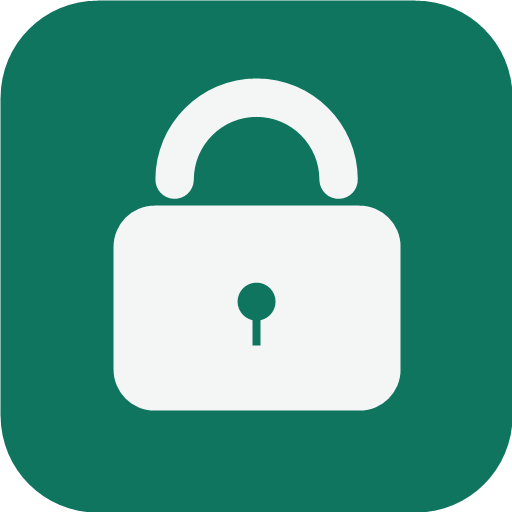

  

<h1 align="center">明月加密</h1>

把私密文件变成一张加密图片。

  <a href="https://github.com/mmblll/mingyue-encryption/releases/latest">下载 APK</a> ·
  <a href="https://github.com/mmblll/mingyue-encryption/issues">反馈问题</a> ·
  <a href="LICENSE">免费使用 · 禁止售卖</a>

明月加密 1.4 采用 AES-256 对称加密：用户输入的密码先经 PBKDF2 加随机盐派生出 256 位密钥，每次加密生成随机 IV，再用 AES-256-GCM 对文件内容加密并校验完整性；多个文件会分别加密后打包封装成一张 PNG 加密图，封面只作展示。解密时输入同一密码派生密钥还原原文件，全程本机完成、不联网，保存后自动清理临时密文。

**可以免费使用、学习、修改和免费分享；禁止出售原版、改版、源码及收费打包。**

## 能做什么

- 图片、视频、音乐、文本和其他文件都能加密，解密后还原原文件。
- 多个文件可以混合打包，合成一张加密 PNG，解密后得到 ZIP。
- 默认生成噪点封面，也可以用普通照片作封面；加密完成后直接预览。
- 每次新加密或解密任务都手动输入密码，不预设、不在任务之间记住密码。
- 只有“加密 / 解密”两个入口，没有内部相册；保存并校验后清理临时密文。
- 软件内允许截图。退到后台或锁屏后清理当前任务。

加密处理在本机完成，应用不申请 `INTERNET` 权限。照片封面是公开可见的，请不要拿隐私照片作封面。

## 安装与使用

在 [Releases](https://github.com/mmblll/mingyue-encryption/releases) 下载 APK。当前版本 **1.4.2**，支持 **Android 6.0 及以上**；不同手机的图片解码与音视频播放能力可能不同。

1. **加密：** 选择文件或输入文字 → 手动输入密码 → 加密 → 保存加密图片。
2. **解密：** 选择原始加密 PNG → 手动输入原密码 → 解密 → 预览或保存原文件。

原版用户请直接覆盖安装，不要先卸载。有旧版相册文件时，“更多”里会提供导出旧版文件的入口。

## 发送前看这里

**加密 PNG 必须按原文件保存和发送。** QQ、微信等应用的图片压缩、重新编码、裁剪或转 JPG，可能删除其中的密文，导致无法解密。建议作为文件发送，或先装进 ZIP 再发送；收到 ZIP 后先解压，再选择里面的 PNG。

当前版本**不支持压缩图片恢复，也没有自动 ZIP 分享模式**。丢失的密文无法通过改后缀恢复。密码忘记也无法找回内容。

## 源码与构建

使用 Kotlin、Jetpack Compose 和 Android 自带加密接口。项目没有上传签名私钥、密码或个人文件。

- JDK 21、Android SDK Platform 37（本项目已验证的环境）。
- Windows：`gradlew.bat :app:assembleDebug`
- macOS / Linux：`./gradlew :app:assembleDebug`
- 加密核心测试：`gradlew.bat cryptoChecks`，其他系统使用 `./gradlew cryptoChecks`。

Debug 包使用独立应用 ID，可以与发布版共存。[详细构建说明](docs/BUILDING.md) · [加密格式与限制](docs/FORMAT.md)

已通过 52 项核心测试，包含 PNG/JPG/GIF 原文件还原、错误密码、密文篡改和流式大文件处理。尚未完成所有手机真机兼容测试，也没有经过独立安全审计。

## 反馈与贡献

欢迎提 Issue 或 Pull Request。反馈时请附手机型号、Android 版本和复现步骤，**不要上传真实密码、私密图片或原始文件**。

联系开发者：**QQ 2703568134**，**mmblll1234567@gamil**

本项目采用作者自定义的中文 [免费使用与禁止售卖许可](LICENSE)，不是 GPL 或标准开源许可证。源码公开供学习和改进，不代表可以拿来售卖。完整边界见 [许可说明](docs/LICENSING.md)。第三方依赖遵循各自许可证，见 [第三方说明](THIRD_PARTY_NOTICES.md)。
